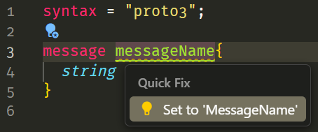
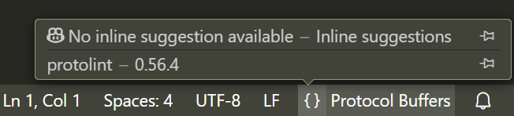

# [`protolint`] for Visual Studio Code

Integrates [`protolint`] into VS Code.

## 📀 Installation

To use this extension, you need to install [`protolint`] via any convenient
method. Follow instructions at
<https://github.com/yoheimuta/protolint#installation>.

The minimum supported version is `0.58.0`. If you are stuck on an older binary,
please read our [Migration & Downgrade Guide][stdin-migration].

## ⚙️ Configuration

### `protolint.command`

[`⚙️protolint.command`] setting specifies the command to run `protolint` or the
absolute path to its executable file.

If `protolint` is added to the system's `PATH`, typically the default
configuration should work correctly.

Relative paths must start with a `./` and are supported only for Folder
settings. In that case, the path will be resolved relative to the root of the
corresponding Workspace Folder.

For example, if you've installed `protolint` into your project through `npm`,
you can set the following value for the Workspace Folder setting:

```text
./node_modules/protolint/bin/protolint
```

On Windows, you can omit the `.exe` file extension, so the example configuration
works across all operating systems.

## ✨ Features

### 🔍 Lint-on-Type

Diagnostics generated by `protolint` update automatically when editing a
`.proto` file without saving it.

This operation runs completely in memory via `stdin`, no temporary physical
files needed.

The diagnostics for untitled protobuf documents is provided only when there is a
protobuf language extension active in VS Code and the document language ID is
`"proto3"`.

### 💡 Quick Fixes

Some problems allow applying granular quick fixes directly.



### 💡 Autofix

`protolint lint -fix` corrections are applied to the selected document while
keeping the original `.proto` file unchanged on disk.

Use the editor command `protolint.editorAutofix` to autofix the active document.

### 📐 Support for `.protolint.yaml`

The extension fully delegates configuration discovery to the native `protolint`
CLI logic but has some nuances due to the `stdin` execution context:

- In single-folder and [multi-root workspace] modes, only configuration files
  located at the root of a Workspace Folder are considered. Any nested
  configuration files (located in subdirectories deeper than the active
  Workspace Folder root) are ignored. For multi-root workspaces, the closest
  Workspace Folder root is used as the execution directory.
- Untitled protobuf documents do not inherit these configurations.

### 📂 [Multi-Root Workspace][multi-root workspace] Support

Different versions of the `protolint` binary can be set up per Workspace Folder.

### 💬 Language Status Item

A language status item shows the `protolint` version used for the active
`.proto` file.



## 📄 License

This project is licensed under the terms of the MIT license.

## 📜 Attribution

This extension uses the utility [`protolint`].

The icon design was inspired by the `TSLint` logo.

## 🌟 Help Us Grow

If you found this extension useful, please rate it on the Visual Studio
Marketplace and give us a star on GitHub. Your support helps more people
discover and benefit from our tool. Thank you!

## 🤝 Contributing

Will be documented later.

[`protolint`]: https://github.com/yoheimuta/protolint
[stdin-migration]:
    https://github.com/AlexCannonball/protolint-vscode/blob/main/docs/stdin-migration.md
[`⚙️protolint.command`]: vscode://settings/protolint.command
[multi-root workspace]:
    https://code.visualstudio.com/docs/editing/workspaces/multi-root-workspaces
